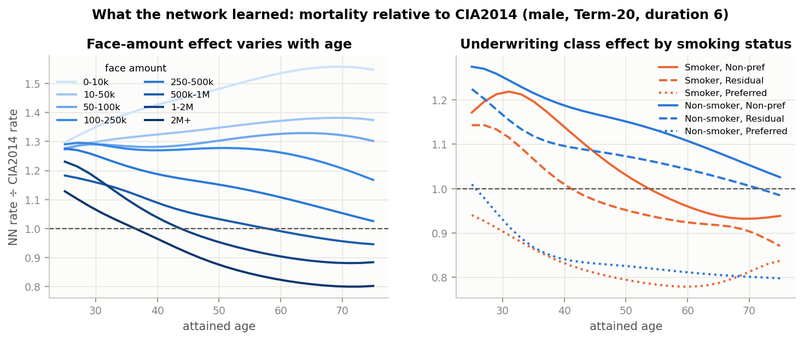

# Neural-Network Mortality Modelling on Canadian Individual Life Experience

**Can a neural network predict insured deaths better than the CIA2014 mortality table and a Poisson GLM?**
Yes. On a held-out policy year (2023-24), a feed-forward network with entity embeddings, trained as a correction to CIA2014, cut the Poisson deviance by about 2,000 compared with the table and by about 1,100 compared with a GLM whose interactions I added by hand. It also found effects the table misses, which change 20-year term premiums by up to ±20%.

*MGSC 673 (Deep Learning), McGill MMA. Individual project by Rina Xu.*



## Data
[Canadian Institute of Actuaries – Canadian Individual Life Experience, Database 2010-2024](https://www.cia-ica.ca/publications/226068de/). It has 15 policy years and about 10 M rows. Each row is a cell of insured lives (sex, smoking status, underwriting class, product, face-amount band, issue age, duration, attained age), with its exposure, its deaths and the deaths expected under CIA2014. I modelled 2016-17 to 2023-24: about 71 M policy-years and 593 k deaths. The data is **not included** in this repository. Download the zip from the CIA and put the `ILMSdb*.csv` files in `data/`.

| Split | Policy years | Rows | Deaths |
|---|---|---|---|
| Train | 2016-17 → 2021-22 | 3.6 M | 429 k |
| Validation | 2022-23 | 0.67 M | 83 k |
| Test | 2023-24 | 0.68 M | 81 k |

## Approach
* **Likelihood.** Every model uses the same Poisson likelihood with a log-exposure offset, `log μ = log E + f(x)`. Rates are therefore learned from rare deaths without discarding the many zero-death rows.
* **Benchmarks.** The CIA2014 table (raw and recalibrated), a main-effects Poisson GLM with B-splines, and a GLM with age × sex and age × smoking interactions.
* **Network.** Entity embeddings for the 6 categorical variables and standardised age and duration feed an MLP with SiLU activations, trained in PyTorch with Adam, early stopping and a plateau LR schedule.
* **Experiments.** Six rounds, all judged on the validation year against a measured seed-noise level (s.d. ≈ 160):
  1. learning rate and batch size;
  2. depth, width and embedding size;
  3. dropout and weight decay;
  4. calendar-year input and dropping the COVID years from training;
  5. structure: plain network vs **CANN** (correction to the GLM) vs a correction to CIA2014;
  6. balance correction and seed ensembling.

## Results (test year 2023-24)

| Model | Poisson deviance ↓ | Level-adjusted deviance ↓ | A/E |
|---|---|---|---|
| CIA2014 table | 127,655 | 127,584 | 0.971 |
| GLM, main effects | 128,064 | 127,981 | 0.969 |
| GLM + age interactions | 126,762 | 126,671 | 0.967 |
| Neural network (plain) | 125,982 | 125,813 | 0.956 |
| **NN on CIA2014 offset, 5-ensemble** | **125,650** | **125,558** | 0.967 |

What I took from the project:
* **CIA2014 is a strong baseline.** A main-effects GLM does worse than the table, and only models that capture interactions beat it.
* **When the network and the GLM disagree, the data sides with the network** (double-lift chart).
* **The network learned an age × face-amount interaction.** By age 70, mortality ranges from 0.8× the table for $2M+ policies to 1.5× for policies under $10k. It also learned a ~20% preferred-class discount. Both are absent from the table.
* **No model forecast the lighter overall level of 2023-24.** The gain is in relative risk, not in the level of mortality.
* **A data bug was caught through diagnostics.** I had capped duration and then recomputed attained age, which mis-aged long-duration policies. The baseline network's A/E then drifted with calendar year even though the network had no year input, and tracing that drift exposed the bug.

## Repository
```
ILM_mortality_NN.ipynb   full analysis (runs top to bottom; outputs saved)
figures/                 all figures
results/                 experiment and evaluation tables (CSV)
models/runs/             every trained network (re-used when RETRAIN = False)
models/final_ensemble.pt final 5-network ensemble
```

## Reproduce
```bash
pip install numpy pandas scikit-learn matplotlib torch jupyter
# put ILMSdb0910.csv ... ILMSdb2324.csv in data/
jupyter nbconvert --to notebook --execute ILM_mortality_NN.ipynb
```
With the saved networks in `models/runs/`, a full run takes a few minutes. Retraining everything (`RETRAIN = True`) takes about 2 hours on a 2-core CPU.

## References
* Schelldorfer, J. & Wüthrich, M. V. (2019). *Nesting Classical Actuarial Models into Neural Networks.* SSRN.
* Richman, R. & Wüthrich, M. V. (2020). *Nagging Predictors.* Risks, 8(3).
* Guo, C. & Berkhahn, F. (2016). *Entity Embeddings of Categorical Variables.* arXiv:1604.06737.
* Canadian Institute of Actuaries (2014). *Final Report: CIA2014 Mortality Tables.*
